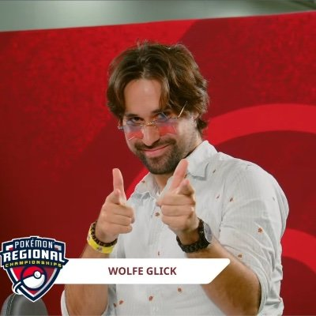
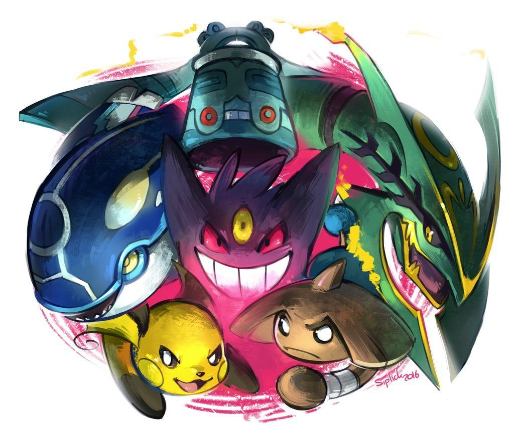

# Wolfey
"Ive earned the right to believe that i am the best player of all time"

https://www.youtube.com/channel/UC9OZkS1Mhl5UvKSiPrYqsxg
[WolfeyVGC YouTube](https://www.youtube.com/channel/UC9OZkS1Mhl5UvKSiPrYqsxg)
V roce 2016 byl jasnej nejsilnějši tým v historii Pokemonu nazývaný The Big Six.
Jedina možnost jak tento tým porazit bylo hrat jednu z variaci stejnýho týmu a tak tento tým použival každej hrač který chtěl zvitězit v World Championship turnaji.
až tedy na jednoho.
"How to stop an unstopable team".
Wolfey vymyslel tým který při idealní hře v teorii mohl porazit nejvic dominujici tým v historii pokemonu.

[WolfeyVGC YouTube](https://www.pokemon.com/us/play-pokemon/worlds/2016/teams/masters)

"1400 people showed up to this tournament hoping and dreaming to win the entire thing... But it wasnt enough!"

Wolfey se svým vlastnoručně udělaným týmem vyhral 1. místo a dokazal že neexistuje věc jako nejsilnějši tým
a jedinej duvod proč byl ten tým tak dominujici byl že ostatni byli přiliš spatní aby ho porazili

A proto je WolfeyVGC považovan jako nejsilnějši a nejlepši hrač v double battles formatu

"And this time the crowd cheers for me, not against me"
